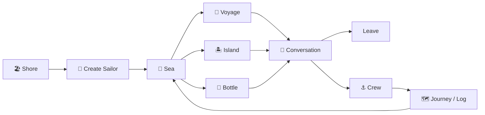
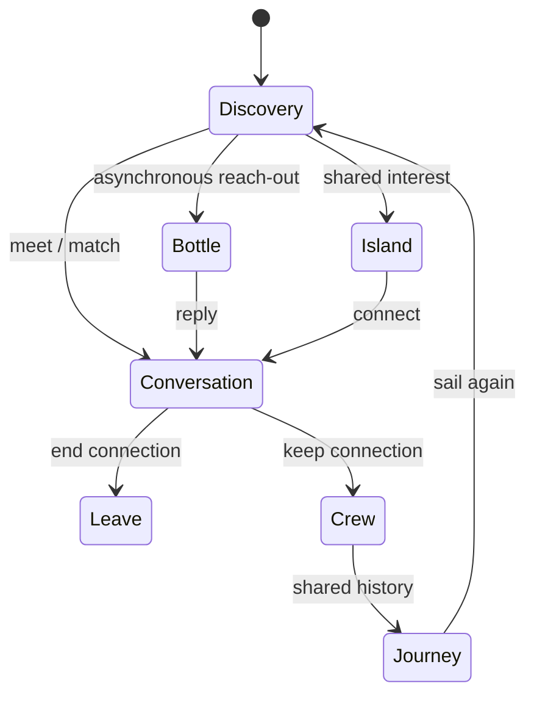

# 🌊 Sailor

> **A social world built around curiosity, conversation, and the people you meet along the way.**

Sailor is a social-discovery platform designed to make meeting strangers feel natural rather than transactional. Instead of optimizing for followers, likes, streaks, or endless feeds, Sailor is built around a simple idea: **enter the sea, discover someone interesting, have a conversation, and decide whether they should stay aboard.**

Sailor is being developed as a flagship product in the **.dot** ecosystem.

> **Preview status:** This repository is a front-end prototype. It uses sample sailors and simulated conversations; account sign-in, real-time messaging, and server-backed persistence are not connected. Your demo profile is stored in your browser. Do not enter a real password.

## What works in the preview

- Create a local demo profile and explore the Sailor interface.
- Try the sample voyage, conversation, crew, islands, bottles, and map flows.
- Install the web app where the browser supports PWA installation.

These flows are for product exploration. Sample people and replies are not real users, and actions do not contact anyone.

## 🧭 The Sailor Experience



**How to read it:** Sailor is a discovery loop. The Sea exposes several ways to meet people; conversation is the central human interaction; Crew and the Log turn worthwhile encounters into continuing relationships.

| Concept | Purpose |
|---|---|
| 🏖️ **Shore** | Entry point for new and returning sailors |
| 🌊 **Sea** | The core discovery space |
| 🧭 **Voyage** | Meet another person through discovery/matching |
| 🏝️ **Island** | Find people connected by an interest or topic |
| 📨 **Bottle** | Reach someone asynchronously |
| 👀 **Peek** | Discover who is around without forcing interaction |
| 💬 **Conversation** | The actual human connection |
| ⚓ **Crew** | People you choose to keep around |
| 🗺️ **Map / Log** | Your record of people and experiences |

## 🔄 Conversation State Flow



## ✨ Current Product Surface

The current Next.js implementation contains the foundations of the Sailor world:

- Shore/onboarding and sailor identity.
- Sea and random-voyage discovery concepts.
- Conversation/chat flows.
- Crew for keeping connections.
- Islands for interest-based discovery.
- Bottles for asynchronous communication.
- Map / Captain's Log concepts.
- Profile and identity management.
- Leave, block/report and safety foundations.
- PWA support with a service worker and installable experience.
- Motion-driven UI intended to make Sailor feel like a **place**, not another dashboard.

The repository is actively evolving; source code is the implementation source of truth and `PRODUCT_VISION.md` captures the longer-term direction.

## 🗺️ Product Roadmap

### Sailor 0.1 — Shore → First Conversation
Onboarding, identity, Sea, Random Voyage, matching, chat, leaving, safety foundations, and basic Crew.

### Sailor 0.2 — The Social Ocean
Real accounts, real-time chat, real matching, Crew, Islands, Bottles, Peek, presence, and stronger safety infrastructure.

### Sailor 0.3 — The World
Map, Captain's Log, richer Islands, voyage history, discovery improvements, events, notifications, moderation, and deeper animation.

### Sailor 1.0 — The Network
Advanced matching, community infrastructure, anti-bot systems, moderation at scale, mobile/PWA maturity, monetization, and scalability.

**There is intentionally no finish state.** Sailor is meant to grow as a social world rather than become a game that can be completed.

## 🚫 What Sailor Is Not

Sailor deliberately avoids:

- Daily-streak pressure or XP grinding.
- Follower-count popularity races.
- Pay-to-talk mechanics.
- Giant tutorials or lore dumps.
- Community hierarchies that simply imitate Discord.
- Automatic punishment based only on report counts.
- A "complete the app" progression loop.

The intended retention loop is **people + curiosity + community**.

## 🛠️ Technology

| Layer | Technology |
|---|---|
| Framework | Next.js 16, React 19 |
| Language | TypeScript |
| Styling | Tailwind CSS 4 |
| Motion | Motion |
| Icons | Lucide React |
| Web App | PWA / Service Worker support |

## 🚀 Run Locally

```bash
git clone https://github.com/cser-utkarsh-raj/Sailor.git
cd Sailor
npm install
npm run dev
```

Open `http://localhost:3000`.

```bash
npm run build
npm start
npm run lint
```

For a fresh local preview, clear this site's browser storage. The demo profile and onboarding choice are kept in `localStorage`.

## 🏗️ Structure

```text
Sailor/
├── src/app/
│   └── (main)/
│       ├── bottles/
│       ├── crew/
│       ├── islands/
│       ├── map/
│       ├── profile/
│       └── sea/
├── public/
├── PRODUCT_VISION.md
└── ARCHITECTURE.md
```

## 🌐 Part of .dot

Sailor is a flagship product within **.dot**, an ecosystem spanning social products, developer infrastructure, and lightweight public tools.

> **Sailor · Presented by .dot**

